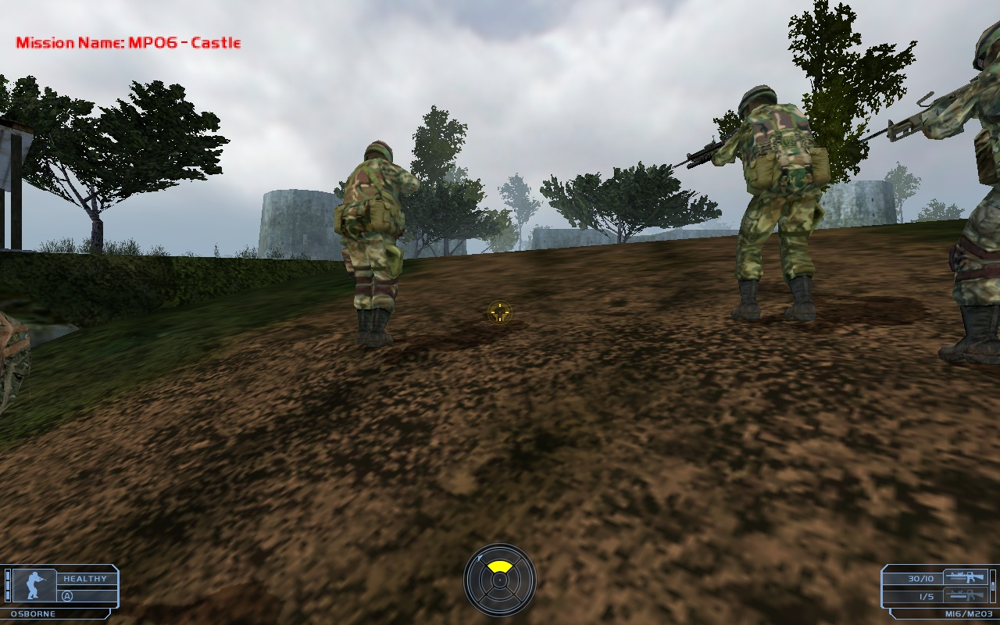
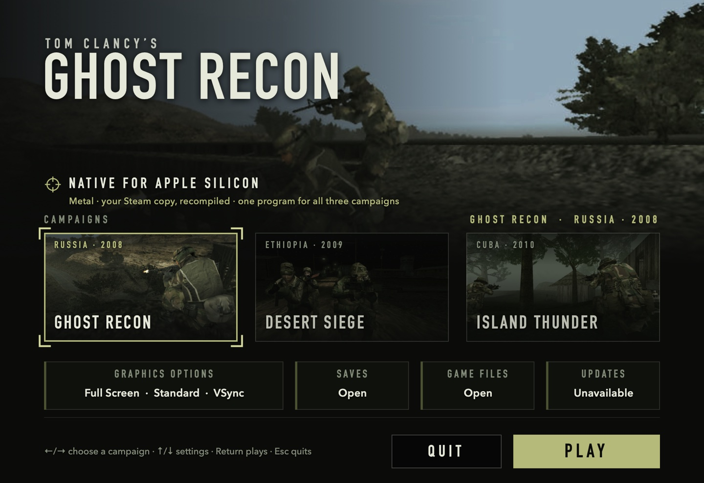
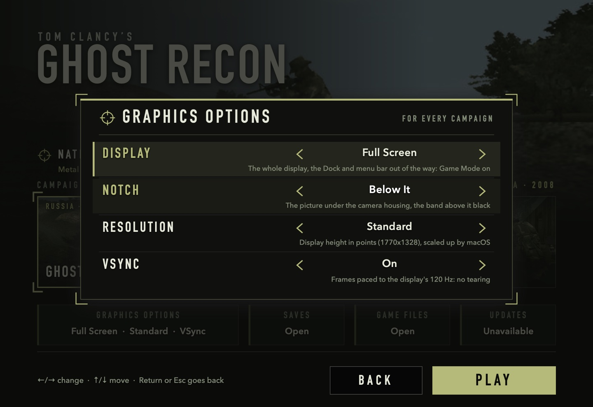
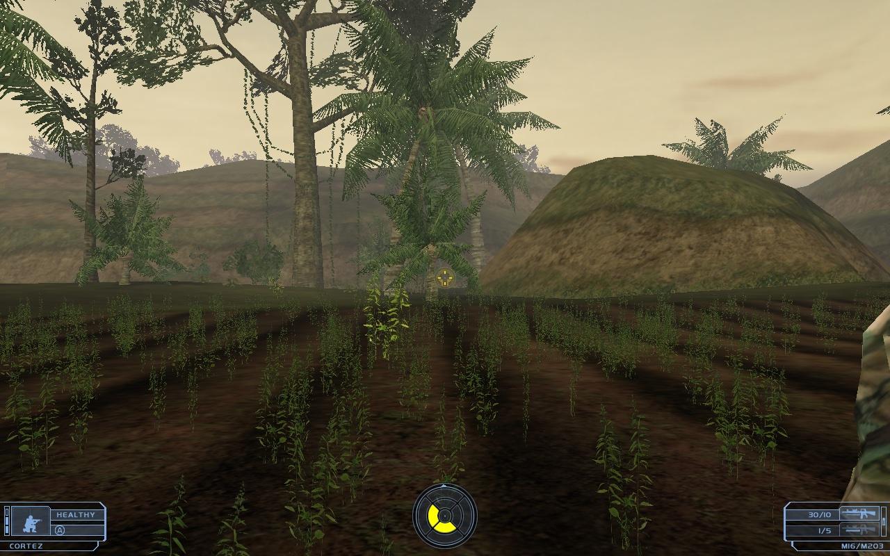
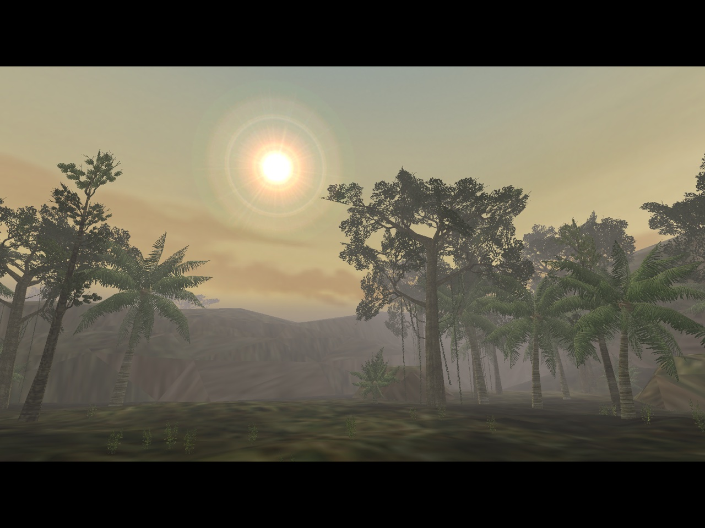
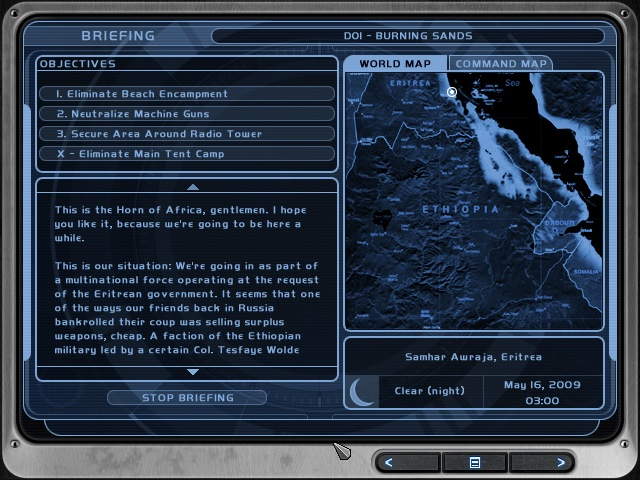
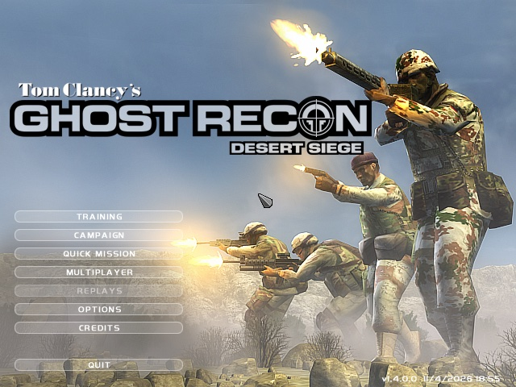
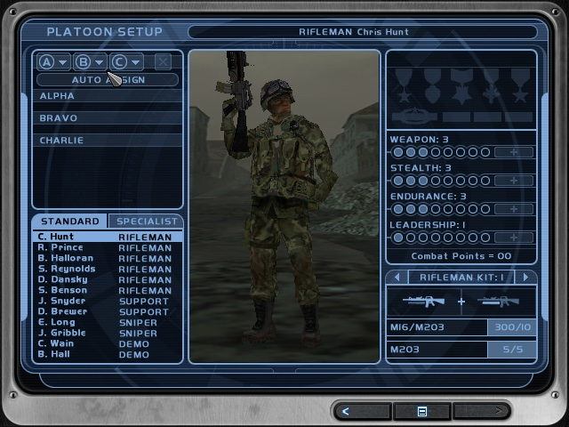
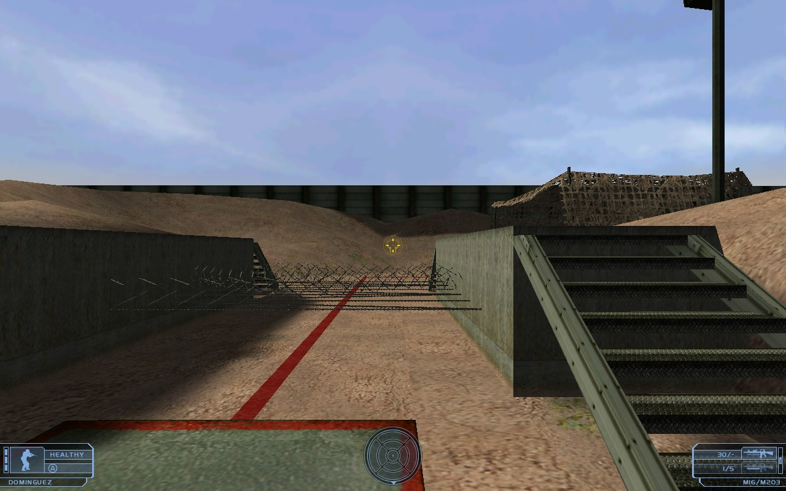

# Ghost Recon, native for Apple Silicon

Red Storm's **Tom Clancy's Ghost Recon** (2001) and its expansions **Desert Siege** and **Island Thunder**,
statically recompiled from your own Steam copies into native arm64 code: no Wine, no Rosetta, no emulator. It uses
the same recompiler and runtime as the author's Rainbow Six, Delta Force, GTA Classics, Dungeon Siege and Fallout:
New Vegas ports, with the game's Direct3D 8 drawn through Metal.



Ghost Recon on Steam (app 15300) is Windows-only. The expansions (Desert Siege 13620, Island Thunder 13630) are mod
folders (`Mods/Mp1`, `Mods/Mp2`) for the same `GhostRecon.exe` 1.4, so one recompiled program plays all three.

Nothing from the games is in this repository. `./install.sh` imports your copies, undoes the Steam wrapper on a copy
in the build folder, recompiles it on your Mac and installs one app, **Ghost Recon**, with a card for the base game
and each expansion.

## Features

- **One app, three campaigns.** The launch window has a card for Ghost Recon, Desert Siege and Island Thunder. Each
  starts the same native program with that campaign's mod set, its own menus and its own saves.
- **Native and fast.** 40,000 recompiled functions running as arm64 code; Direct3D 8 drawn through Metal. Missions
  hold 60 fps at 1280x800 with the GPU at about 1.3 ms a frame (M1 Pro).
- **Better texture filtering.** The game's "Mipmap Textures" option works and is on by default. On top of what Windows
  did, 16x anisotropic filtering keeps the ground sharp at a slant (`DSR_ANISO=1` turns it off).
- **Graphics Options for the Mac.** Full screen (with Game Mode) or a window; the picture below the notch or around
  it; Standard or Retina resolution; VSync.
- **LAN multiplayer.** Host and join over the local network from the game's own Multiplayer menu.
- **Your files stay as they were.** The game folder is never written to; settings, saves and logs go to a separate
  data folder.
- **Updates from the launch window.** The Updates tile rebuilds the app from the branch it follows.

## Screenshots

| | |
|---|---|
|  |  |
| The launch window: one card per campaign | Graphics Options: display, notch, resolution, VSync |
|  |  |
| Island Thunder, Cuba | Island Thunder's opening flyover |
|  |  |
| Desert Siege briefing, D01 Burning Sands | Desert Siege main menu |
|  |  |
| Platoon setup | Training: the obstacle course |

## Requirements

- An Apple Silicon Mac with macOS 13 or later (tested on macOS 27).
- Ghost Recon on Steam (app 15300). Desert Siege (13620) and Island Thunder (13630) are optional; each one you own
  adds its card.
- The Xcode command line tools (`xcode-select --install`), for clang and python3. The installer puts the recompiler's
  Python package (Capstone) into `recomp/.venv` itself.
- About 1 GB free for the build. The imported game is an APFS clone of the Steam download, so it takes no extra space
  until one of them changes.

## Getting the game files

Steam on macOS won't install Windows-only games, but its console downloads their depots. Open
`steam://open/console` and run:

```
download_depot 15300 15301
download_depot 13620 13621
download_depot 13630 13631
```

They land in Steam's `steamapps/content/app_<id>/depot_<id>` folders, where `./install.sh` finds them. Once the app
is installed the depots can be deleted: the game lives on in the data folder.

## Installing

```sh
git clone https://github.com/Joshspeakman/ghost-recon-macos.git
cd ghost-recon-macos
./install.sh                     # "Ghost Recon.app" in ~/Applications
./install.sh --branch nightly    # "Ghost Recon Nightly.app": the development branch
```

The first build takes around fifteen minutes (it recompiles the whole game). `./install.sh --help` lists the options:
another game folder (`--game-dir`), data folder (`--data-dir`) or app folder (`--app-dir`), `--no-downloads` (plain
launch-window art instead of Steam's store art), and `--in-place` (read the game from where it is, copy nothing).

## Playing

Open **Ghost Recon** from `~/Applications`. In the launch window:

| | |
|---|---|
| ← / → or click | choose a campaign: Ghost Recon (Russia 2008), Desert Siege (Ethiopia 2009), Island Thunder (Cuba 2010) |
| Play or Return | start it |
| Graphics Options | Display (Full Screen, Window), Notch (Below It, Around It), Resolution (Standard, Retina), VSync |
| Saves | opens the chosen campaign's save folder in Finder |
| Game Files | opens the imported game folder |
| Updates | checks GitHub for a newer build of the app's branch and rebuilds it |
| Esc | quits |

In game, the controls, video options and key bindings are Ghost Recon's own (Options in the main menu). The menus
always run at 640x480, as on Windows; missions use the resolution chosen in Graphics Options.

**Movies** (the intros and campaign cut-scenes) are skipped for now: they're MS-MPEG-4 v2 and Indeo 3.2 AVIs, and
the runtime has no decoder for either yet.

### Multiplayer

Multiplayer → LAN hosts or joins games on the local network. The first time, macOS asks whether Ghost Recon may find
devices on your local network: choose **Allow**, or other players won't see your game. (If you said no: System
Settings → Privacy & Security → Local Network.)

LAN play has been tested between two copies on one Mac (host, join, lobby, a full round). Two separate Macs haven't
been tried yet, and neither has internet play.

## Where things are

| | |
|---|---|
| `~/Applications/Ghost Recon.app` | the app (`Ghost Recon Nightly.app` for the nightly branch) |
| `~/Games/GhostReconNative/game-files/GhostRecon` | the imported game, with the expansions merged in (`Mods/Mp1`, `Mods/Mp2`) |
| `~/Games/GhostReconNative/game` | settings (`options.xml`), the game's log (`Ike.log`) and saves: `data/save` for Ghost Recon, `mods/mp1/save` and `mods/mp2/save` for the expansions |
| `~/Games/GhostReconNative/launcher.plist` | the launch window's choices |
| `~/Games/GhostReconNative/CrashReports` | a report for each crash or hang, shown in a dialog the next time the app opens |

**Uninstalling:** delete the app. Delete `~/Games/GhostReconNative` as well to remove the imported game, settings and
saves.

## State

**Playable, in development.** Checked so far:

| | |
|---|---|
| Ghost Recon | menus, Training, quick mission (Castle, with a full fireteam) |
| Desert Siege | new campaign → D01 Burning Sands, firing, save, quit, load |
| Island Thunder | new campaign → the C01 intro and the start of the mission |
| Graphics | Direct3D 8 fixed function on Metal: two-layer terrain (colour map + detail), vertex lighting, mipmaps, 16x anisotropic filtering |
| Sound | DirectSound: music, effects, voice (EAX not offered) |
| Input | DirectInput 8 mouse and keyboard |
| Multiplayer | LAN host and join (two copies on one Mac) |
| Movies | skipped (no MS-MPEG-4 v2 / Indeo 3.2 decoder yet) |

[docs/GR-PORT.md](docs/GR-PORT.md) has what was specific to this game, the runtime fixes it needed, and how it is
tested.

## Building by hand

```sh
recomp/build_gr.sh ~/Games/GhostReconNative/game-files/GhostRecon      # -> recomp/work/gr/app/GhostRecon
recomp/run_gr.sh                                                        # run it in test mode
```

[recomp/README.md](recomp/README.md) covers the recompiler, the runtime, and the test and debugging switches.

## How it works, briefly

`build_gr.sh` checks that `GhostRecon.exe` is the Steam 1.4 build, removes the SteamStub 2.0 wrapper from a copy
(`recomp/tools/steamstub20.py`), finds every function in it (`analyze.py`) and translates each one from x86 into C
(`lift.py`). clang compiles that C for arm64 and links it with a runtime that provides the Windows functions the game
calls: files, threads, Direct3D 8, DirectSound, DirectInput, Winsock. Direct3D draws through a Metal renderer
(`src/renderer`); the Mac host (`recomp/host/main.m`) supplies the window, input, sound output and the launch window.

This repository was forked from gta-classics-macos (which came from delta-force-macos and the Dungeon Siege II port);
the runtime still carries modules of those ports.

## Credits

Ghost Recon, Desert Siege and Island Thunder © Red Storm Entertainment / Ubisoft. This project contains none of the
games' files; see [NOTICE.md](NOTICE.md) for what it includes and what it learned from. Code: MIT ([LICENSE](LICENSE)).

## A note from the author

These projects are roughly 90% built with AI, with human testing along the way. I started them because some of my
favorite games either ran badly on macOS or wouldn’t run at all, and Wine and CrossOver didn’t always get me where I
wanted.

I’m a 40-year-old dad with a full-time job. I don’t have the time or desire to write all of this from scratch, and AI
made it possible to get somewhere with it.

If that puts you off, no hard feelings. Use them, skip them, fork them. It’s all good. I would have happily used an
existing, human-written native port, but I couldn’t find one that did what I wanted. Mostly, I just want to play my
games.

The aim is straightforward native builds without unwanted extras or a stack of translation layers. Forks and
improvements are welcome.
